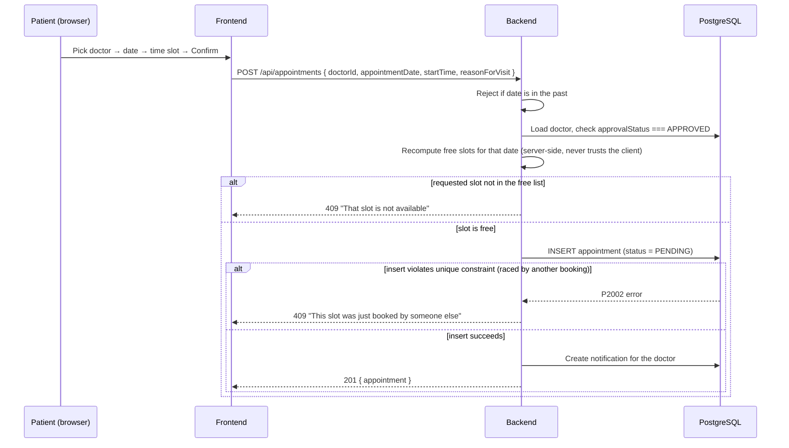

# Appointment Booking Flow

This is the most important piece of business logic in the project — worth understanding in
detail for an interview.

## 1. From weekly availability to bookable slots

A doctor doesn't set individual slots one by one. Instead they define **recurring weekly
windows** in `doctor_availability`, e.g. "Monday 09:00–13:00, 30-minute slots". When a patient
picks a date, the backend expands that window into concrete slots on the fly:

```
generateSlots("09:00", "13:00", 30)
→ [{09:00-09:30}, {09:30-10:00}, {10:00-10:30}, ... {12:30-13:00}]
```

Then it removes:
- Slots that already have a `PENDING` or `CONFIRMED` appointment on that exact date.
- Slots earlier than the current time, if the requested date is today.

What's left is the real-time list of bookable slots — this is exactly what
`GET /doctors/:id/availability?date=...` returns, and what the "Book Appointment" page's
slot grid renders.

## 2. The booking request



The backend **never trusts the frontend's idea of what's free** — it recomputes available
slots itself before booking. The frontend's slot grid is a UX convenience, not a security
boundary.

## 3. Preventing double booking — the real guarantee

Checking "is this slot free?" and then inserting the appointment are two separate steps
(check-then-act). Under concurrent requests, two patients could both pass the check at nearly
the same instant, before either insert commits — a classic race condition.

**The actual guarantee comes from the database**, not the application code:

```prisma
model Appointment {
  ...
  @@unique([doctorId, appointmentDate, startTime], name: "uniq_doctor_slot")
}
```

This tells PostgreSQL: no two rows may ever exist with the same `(doctorId, appointmentDate,
startTime)`. If two `INSERT`s race, the database itself allows the first and rejects the
second — atomically, no matter how the application code is timed. Prisma surfaces that
rejection as error code `P2002`, which the controller catches and turns into a friendly `409
Conflict` response asking the patient to pick a different slot.

The application-level "recompute free slots" check described above still runs first — it's
what makes the *common* case (no race) fast and gives a clean error message without even
touching the appointments table. But it is **not** what prevents double booking under
concurrency; the unique constraint is. This is proven by an integration test in
`backend/tests/appointments.test.js` (`"double booking: second request for the identical slot
is rejected"`) that fires two booking requests at the exact same slot concurrently with
`Promise.all` and asserts exactly one succeeds (`201`) and the other is rejected (`409`).

## 4. Reschedule

Rescheduling is implemented as "change date/time on the existing row" rather than
cancel-and-rebook, so appointment history stays intact. It re-runs the same free-slot check
and is subject to the same unique constraint — and resets status back to `PENDING`, since the
doctor should re-confirm a moved appointment.

## 5. Status lifecycle

```
PENDING → CONFIRMED → COMPLETED
   |            |
   ↓            ↓
REJECTED    CANCELLED
   
PENDING → CANCELLED (patient can also cancel before confirmation)
```

- `PENDING`: created by patient, awaiting doctor action.
- `CONFIRMED`: doctor accepted.
- `REJECTED`: doctor declined (terminal).
- `CANCELLED`: patient or doctor cancelled (terminal).
- `COMPLETED`: doctor marked the visit done (terminal).

Once an appointment reaches a terminal state (`COMPLETED`, `CANCELLED`, `REJECTED`), the
backend rejects any further status change, cancellation, or reschedule attempt on it (`400`).

## 6. Authorization on appointment actions

| Action | Who can do it |
|---|---|
| Create | Patient (self) |
| View | Owning patient, owning doctor, or any admin |
| Reschedule | Owning patient, owning doctor, or admin |
| Cancel | Owning patient, owning doctor, or admin |
| Confirm/Reject/Complete | Owning doctor or admin (not the patient) |

Enforced by `assertAppointmentAccess()` and route-level `authorize()` middleware in
`appointmentController.js` / `appointmentRoutes.js`.

## 7. Doctor leave / holiday blocking

A doctor can add a leave entry (a date range, optionally with a reason) via
`POST /api/doctors/leaves`. This is checked **before** the weekly-availability pattern
whenever slots are computed for a date — `getAvailableSlotsForDate()` in
`appointmentController.js` calls `findLeaveForDate()` first, and if the requested date falls
inside an active leave range, it returns `{ slots: [], onLeave: true, leaveReason }` without
even looking at the weekly pattern. This means:

- The slot-picker UI shows a clear "Dr. X is on leave on this date" message instead of a
  generic "no slots available."
- Booking (`POST /api/appointments`) and rescheduling (`PUT /api/appointments/:id`) both reuse
  the exact same function, so a leave blocks new bookings and reschedules identically — there
  is only one source of truth for "is this doctor bookable on this date," not two
  implementations that could drift out of sync.
- Adding a leave does **not** auto-cancel appointments that already exist inside that range —
  a doctor might still choose to see already-booked patients. Instead, the doctor receives an
  in-app notification listing how many existing appointments now conflict with the new leave,
  so they can manually reschedule or cancel them.

## 8. Appointment reminders

A background job (`backend/src/jobs/reminderJob.js`, using `node-cron`) periodically sweeps
`CONFIRMED` appointments and sends a reminder email (plus an in-app notification) 24 hours and
1 hour before the appointment, tracked via `reminder24hSentAt`/`reminder1hSentAt` on the
`Appointment` row so the same reminder is never sent twice.

**Design tradeoff, stated plainly**: rather than firing at an exact instant, each reminder
fires the *first time* the sweep notices the appointment has entered that window
(`appointmentDateTime <= now + 24h`, or `<= now + 1h`) and hasn't been reminded yet. This is
simpler and more robust against a missed cron tick than trying to hit an exact moment — but it
means a doctor confirming a booking only a few hours before the visit will trigger both
reminders in quick succession rather than 24 hours apart. This is documented, not hidden,
because it's a real simplification worth being able to explain in an interview.

Rescheduling an appointment resets both reminder flags to null, since the old reminder timing
no longer applies to the new date/time.

## 9. Medical records

Once a doctor marks an appointment `COMPLETED`, they can attach exactly one medical record to
it (`POST /api/medical-records`, enforced by a unique constraint on `Appointment.id` in the
`MedicalRecord` table) — diagnosis, symptoms, notes, an optional follow-up date, and a
structured list of prescribed medicines (`PrescriptionItem` rows, not a single free-text
field). Submitting the endpoint again for the same appointment updates the existing record and
replaces its medicine list, rather than creating a duplicate.

Access is role-scoped: the patient can view their own records, the treating doctor can view
and edit records they authored, and admins can view any record for oversight — enforced in
`medicalRecordController.js`, mirroring the same ownership-check pattern used for appointments.
