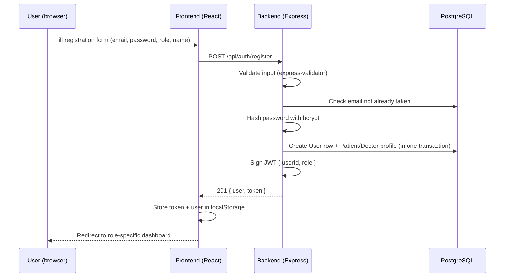
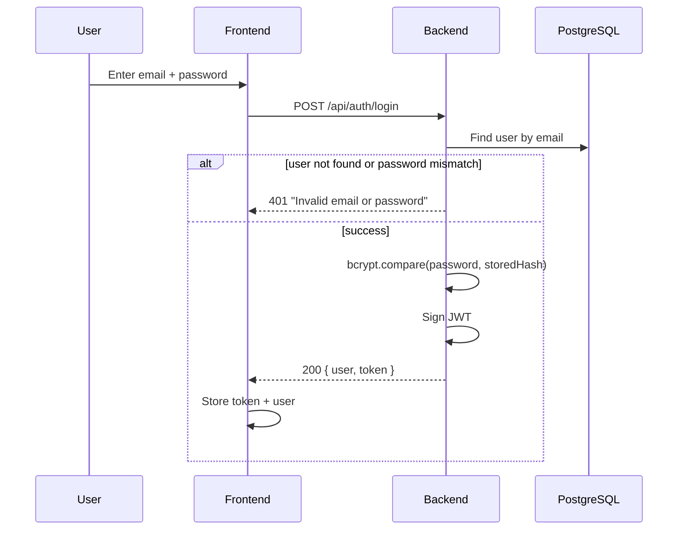

# Authentication Flow

## 1. Registration



Key points:
- Passwords are **never** stored in plain text — `bcrypt.hash(password, 10)` before the row
  is written.
- User + role-profile creation happens inside a **Prisma transaction**
  (`prisma.$transaction`), so if profile creation fails, the user row is rolled back too —
  no orphaned accounts.
- A doctor registering this way starts `approvalStatus: PENDING` and is invisible in public
  search until an admin approves them (see `docs/appointment-flow.md` and the admin doctor
  management page).

## 2. Login



The error message is deliberately identical whether the email doesn't exist or the password
is wrong — this prevents an attacker from using the login endpoint to discover which emails
are registered (user enumeration).

## 3. Authenticated requests

Every subsequent request from the frontend attaches the token automatically via an Axios
request interceptor (`frontend/src/api/axios.js`):

```js
config.headers.Authorization = `Bearer ${token}`;
```

On the backend, the `authenticate` middleware (`backend/src/middleware/auth.js`) runs first
on any protected route:

1. Reads the `Authorization` header, expects `Bearer <token>`.
2. Verifies the JWT signature and expiry with `jsonwebtoken.verify()`.
3. Loads the full user row (plus their `patient`/`doctor` profile) from the database using the
   `userId` embedded in the token payload.
4. Checks the account is still `isActive`.
5. Attaches the loaded user to `req.user` for every downstream handler to use.

If any step fails, it throws a `401 ApiError`, which the centralized error handler turns into
a clean JSON response — the request never reaches the controller.

## 4. Role-based authorization

After `authenticate`, sensitive routes add `authorize("DOCTOR", "ADMIN")` (or whichever roles
are allowed). This simply checks `allowedRoles.includes(req.user.role)` and throws `403` if
not. Some endpoints go further with **resource-level** checks inside the controller — e.g. a
doctor can list appointments, but only *their own* (`assertAppointmentAccess()` in
`appointmentController.js`), not another doctor's.

## 5. Logout

There's no server-side session to invalidate (JWTs are stateless), so "logout" is purely a
frontend action: `AuthContext.logout()` clears `token`/`user` from `localStorage` and the
protected routes immediately start redirecting to `/login` again.

## 6. Why JWT (and its tradeoffs)

JWT was chosen because it's stateless — the server doesn't need to store sessions, which
keeps the backend simple and horizontally scalable. The tradeoff: a JWT can't be
"invalidated" server-side before its expiry (e.g. if a token were stolen, it stays valid until
it expires). For this project's scope (`JWT_EXPIRES_IN=7d` by default), that tradeoff is
acceptable; a production system might add a short-lived access token + refresh token pair, or
a token-blocklist, to mitigate it.
