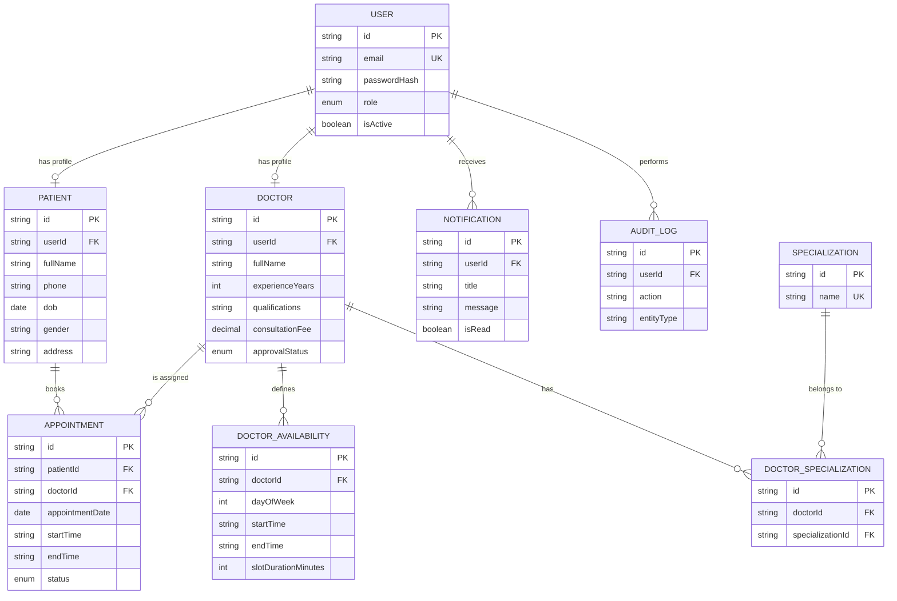

# Database Design

Full schema source of truth: `backend/prisma/schema.prisma`. This document explains **why**
each table exists and how they relate.

## 1. ER Diagram



## 2. Why each table exists

| Table | Purpose |
|---|---|
| `users` | Single source of truth for login identity (email + password hash + role). Every account — patient, doctor, or admin — is a row here first. |
| `patients` | Patient-only profile fields (DOB, gender, address). Kept separate from `users` so the auth table stays small and role-agnostic. |
| `doctors` | Doctor-only profile fields (bio, experience, fee, approval status). Same reasoning as `patients`. |
| `specializations` | Lookup table of medical departments (Cardiology, Dermatology, ...) so they can be reused and filtered on, instead of doctors typing free text. |
| `doctor_specializations` | Join table — a doctor can have multiple specializations, and a specialization applies to many doctors (many-to-many). |
| `doctor_availability` | A doctor's **recurring weekly** free-time windows (e.g. "Mondays 9–1"). The booking engine expands this into concrete slots for a specific date. |
| `appointments` | The core transactional record: who booked whom, when, and its current status. Carries the database-level uniqueness constraint that prevents double booking, plus reminder-sent tracking fields. |
| `doctor_leaves` | One-off leave/holiday date ranges for a doctor, checked before the weekly availability pattern when computing bookable slots — a leave always overrides the recurring schedule for that date. |
| `medical_records` | One record per completed appointment (enforced by a unique constraint on `appointmentId`): diagnosis, symptoms, doctor's notes, and an optional follow-up date, written by the treating doctor. |
| `prescription_items` | One row per prescribed medicine on a medical record (name, dosage, instructions) — kept as its own table rather than a text blob so the medicine list is structured and independently queryable. |
| `notifications` | Simple in-app notification feed per user (appointment requested/confirmed/cancelled/reminders, leave conflicts). |
| `audit_logs` | Lightweight admin-visible trail of sensitive actions (doctor approved/rejected, user activated/deactivated). |

## 3. Relationships explained

- **One-to-one**: `User` ↔ `Patient` and `User` ↔ `Doctor`. A user is *either* a patient *or*
  a doctor (or neither, if admin) — enforced by `userId` being `@unique` on both `Patient` and
  `Doctor`, so at most one profile row can point at a given user.
- **One-to-many**: `Patient` → `Appointment` (a patient can have many appointments, each
  appointment has exactly one patient). Same shape for `Doctor` → `Appointment`,
  `Doctor` → `DoctorAvailability`, `User` → `Notification`.
- **Many-to-many**: `Doctor` ↔ `Specialization`, implemented through the explicit join table
  `DoctorSpecialization` (rather than Prisma's implicit many-to-many) so we can add columns to
  the relationship later if needed and so the relationship is visible/explicit in the schema.

## 4. Constraints & indexes that matter

- `appointments` has a **composite unique constraint** on `(doctorId, appointmentDate,
  startTime)`. This is the database-level guarantee against double booking — see
  `docs/appointment-flow.md` for the full explanation of why this matters more than an
  application-level check.
- `doctor_availability` has a unique constraint on `(doctorId, dayOfWeek, startTime, endTime)`
  to prevent a doctor from accidentally adding the exact same window twice.
- Indexes on `appointments(patientId)`, `appointments(doctorId, appointmentDate)`, and
  `appointments(status)` speed up the three most common queries: "my appointments",
  "a doctor's appointments on a date", and "all pending appointments" (admin dashboard).
- `onDelete: Cascade` is used for profile/child rows (e.g. deleting a `Doctor` also removes
  their `DoctorAvailability` and `DoctorSpecialization` rows) so we never end up with orphaned
  rows pointing at a deleted parent.

## 5. Migrations, seed data, and demo accounts

```bash
npx prisma migrate dev --name init   # applies schema.prisma to the database
npm run seed                         # populates specializations, an admin, 4 approved doctors,
                                      # 1 pending doctor, 2 patients, and 2 sample appointments
```

Demo credentials are documented in the main `README.md`. All seeded passwords are the same
development-only value (`Password@123`), hashed with bcrypt before being stored — the plain
password is never written to the database.
