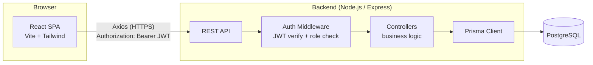

# System Architecture

## 1. High-level overview

MediCare Connect is a **modular monolith**, not microservices. One React single-page
application talks to one Express REST API, which talks to one PostgreSQL database through
Prisma. This is intentional: for a project of this scope, microservices would add deployment
and coordination complexity without any real benefit — a single well-organized backend service
is easier to build, test, run, and explain in an interview.



## 2. Frontend architecture

- **React Router** drives client-side navigation; routes are grouped by role
  (`/patient/*`, `/doctor/*`, `/admin/*`) and wrapped in `<ProtectedRoute roles={[...]}>`.
- **AuthContext** (`src/context/AuthContext.jsx`) holds the logged-in user and JWT, persisted
  to `localStorage` so a page refresh doesn't log the user out.
- **API service layer** (`src/api/*.js`) is the only place that calls `axios` — components
  never construct requests directly. This keeps API shapes in one place and makes it trivial
  to see every backend call the frontend makes.
- **Shared components** (`Navbar`, `DashboardLayout`, `ProtectedRoute`, `StatusBadge`,
  `ConfirmDialog`, `LoadingSpinner`, `EmptyState`, `ErrorMessage`) keep every dashboard page
  visually and behaviorally consistent instead of re-implementing loading/error/empty states
  per page.
- **Tailwind CSS** utility classes handle styling; a few semantic component classes
  (`.btn-primary`, `.card`, `.input`, `.badge`) are defined once in `index.css` to avoid
  repeating long class lists everywhere.

## 3. Backend architecture

Classic layered structure:

```
routes/        → declares URL + HTTP method → which controller function handles it
                  also wires in auth/authorization/validation middleware per route
validators/    → express-validator rule sets (e.g. "email must be valid")
middleware/    → cross-cutting concerns: auth.js (JWT + role check),
                  validate.js (turns validation errors into a 422 response),
                  errorHandler.js (turns any thrown error into a clean JSON response)
controllers/   → the actual business logic: reads req, talks to Prisma, returns a response
config/        → environment variable loading + the shared Prisma client instance
utils/         → small reusable helpers (JWT signing, slot-time math, response envelope)
```

Request lifecycle for a typical protected endpoint:

```
Request → helmet/cors/rate-limit → express.json() → route matched
        → authenticate (verifies JWT, loads user from DB)
        → authorize("DOCTOR") (checks req.user.role)
        → validators + validate() (checks request body shape)
        → controller (business logic, Prisma calls)
        → success()/failure() response helper
        → (if anything throws) errorHandler middleware → consistent error JSON
```

## 4. Database architecture

PostgreSQL, accessed exclusively through Prisma (no raw SQL in application code, except where
Prisma's query builder wouldn't express something safely — this project didn't need any).
Full schema and rationale: `docs/database-design.md`.

## 5. API architecture

REST over HTTP/JSON. Every response follows the same envelope:

```json
{ "success": true, "message": "...", "data": { ... } }
{ "success": false, "message": "...", "errors": [ ... ] }
```

Full endpoint list: `docs/api-documentation.md`.

## 6. Authentication flow

See `docs/authentication-flow.md` for the full walkthrough. Summary: register/login returns a
JWT; the frontend stores it and attaches it as `Authorization: Bearer <token>` on every
request; the backend's `authenticate` middleware verifies the token and loads the current user
on every protected request.

## 7. Appointment booking flow

See `docs/appointment-flow.md` for the full walkthrough, including exactly how double-booking
is prevented at the database level.

## 8. Role-based authorization flow

Three roles: `PATIENT`, `DOCTOR`, `ADMIN`, stored on the `User` row. Two layers of enforcement:

1. **Frontend** — `<ProtectedRoute roles={["DOCTOR"]}>` redirects unauthorized users away from
   pages they shouldn't see. This is a UX convenience, **not** a security boundary.
2. **Backend** — the real security boundary. `authorize("DOCTOR", "ADMIN")` middleware runs on
   the server for every sensitive route, and controllers additionally check *resource-level*
   ownership (e.g. a doctor can only update appointments assigned to them, a patient can only
   cancel their own appointment) — see `assertAppointmentAccess()` in
   `appointmentController.js`.
